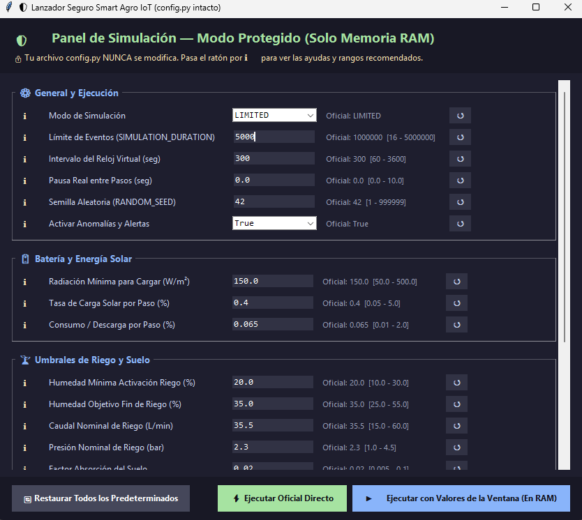
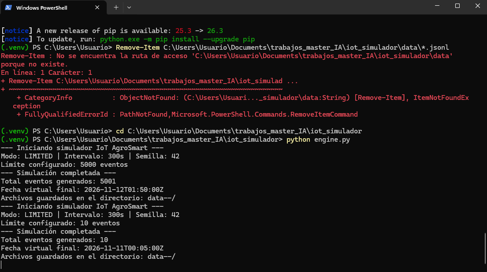
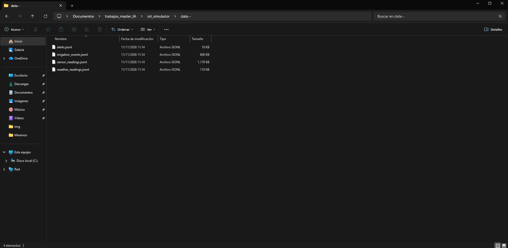
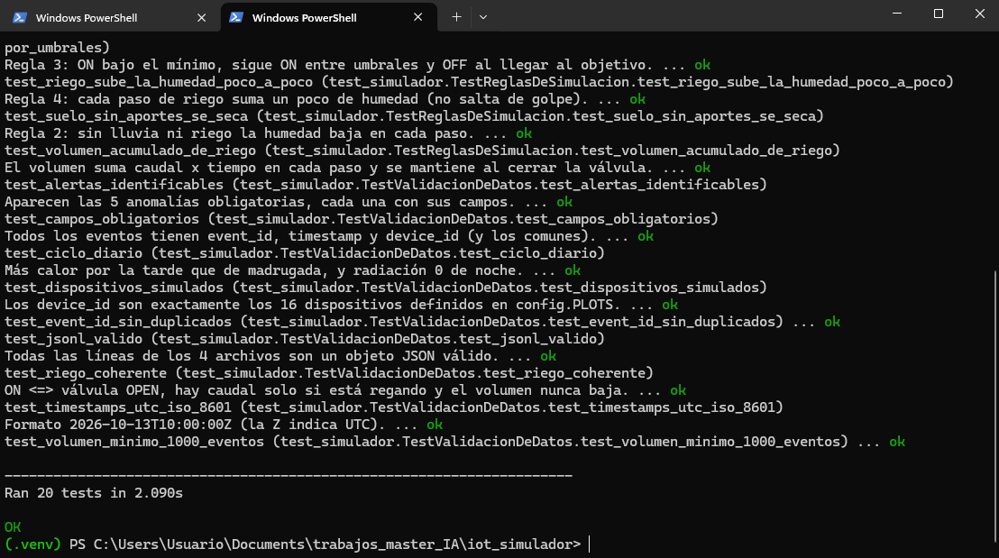
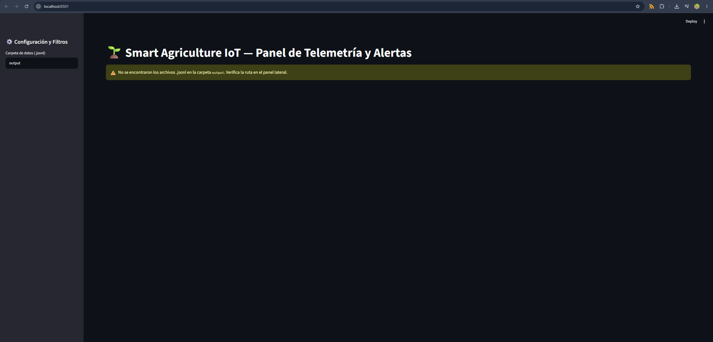
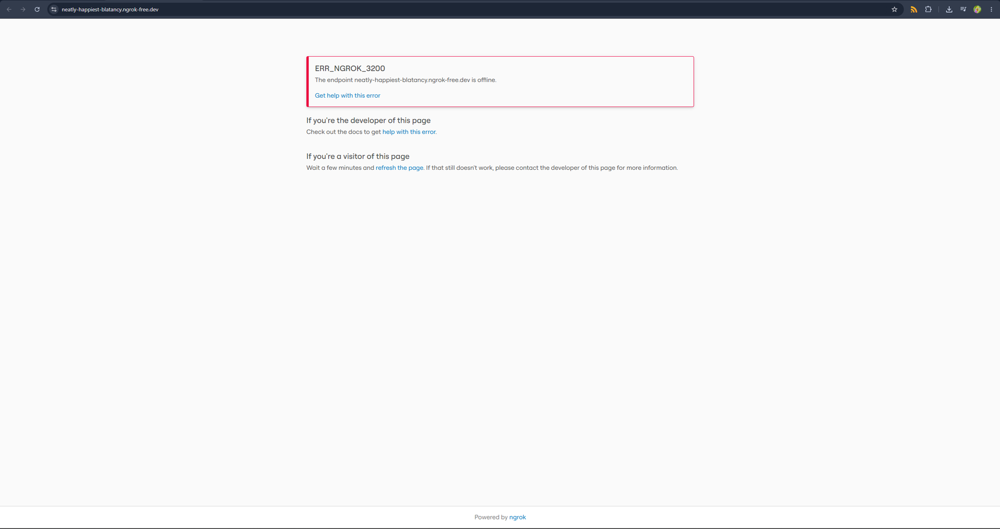

# Ejercicios IoT: evidencias de ejecución

Álvaro García-Quismondo Lizana  
30 de octubre de 2026

Este documento reúne la evidencia de la ejecución de las dos exposiciones: el simulador de agricultura inteligente de Isaac y Emmanuel y la práctica de Power BI de Héctor y Marco. Las capturas están en la carpeta `evidencias_img/`.

## 1. Simulador Smart Agriculture IoT (Isaac y Emmanuel)

El proyecto es el repositorio `BigSierra365/smart-agriculture-iot-simulator`. Lo descargué en `C:\Users\Usuario\Documents\trabajos_master_IA\iot_simulador`, creé un entorno virtual (`.venv`) en `C:\Users\Usuario\Documents\trabajos_master_IA` e instalé las dependencias con `pip install -r requirements.txt`.

### 1.1. Ejecución de engine.py

Lancé el lanzador gráfico desde PowerShell:

```powershell
cd C:\Users\Usuario\Documents\trabajos_master_IA\iot_simulador
python engine.py
```

En la ventana dejé el modo de simulación en LIMITED y cambié el límite de eventos de 1.000.000 (valor oficial) a 5000. El resto de parámetros quedó en sus valores por defecto: intervalo del reloj virtual de 300 segundos, pausa real de 0,0 segundos, semilla aleatoria 42 y anomalías activadas. Los parámetros de batería y de riego también están en sus valores oficiales.



*Figura 1. Ventana de engine.py con el modo LIMITED y el límite de eventos en 5000.*

Con "Ejecutar con Valores de la Ventana (En RAM)" se lanzó la simulación con esos valores sin modificar `config.py`. La consola muestra dos ejecuciones. La primera usa los valores de la ventana: límite de 5000 eventos, 5001 eventos generados y fecha virtual final 2026-11-12T01:50:00Z. La segunda usa los valores de `config.py` (límite de 10 eventos) y genera 10 eventos. En ambos casos el simulador informa de que los archivos se guardan en el directorio `data--/`.

El directorio de salida se llama `data--` porque así está definido en `OUTPUT_DIR` dentro de `config.py` del proyecto. El error en rojo que aparece antes en la consola se produjo al intentar borrar archivos de una carpeta `data`, que no existe en este proyecto.



*Figura 2. Consola de PowerShell con las dos ejecuciones del simulador.*

### 1.2. Archivos JSONL generados

La carpeta de salida contiene los cuatro archivos JSON Lines, uno por tipo de evento, con la fecha de modificación de la ejecución (11/11/2026 11:14):

| Archivo | Tamaño |
|---|---|
| alerts.jsonl | 18 KB |
| irrigation_events.jsonl | 608 KB |
| sensor_readings.jsonl | 1.179 KB |
| weather_readings.jsonl | 110 KB |



*Figura 3. Carpeta `data--` con los cuatro archivos generados.*

Pendiente de añadir: una captura de cada archivo abierto en el editor.

- Figura 4a: `alerts.jsonl` (`evidencias_img/fig04a_alerts_jsonl.png`)
- Figura 4b: `irrigation_events.jsonl` (`evidencias_img/fig04b_irrigation_events_jsonl.png`)
- Figura 4c: `sensor_readings.jsonl` (`evidencias_img/fig04c_sensor_readings_jsonl.png`)
- Figura 4d: `weather_readings.jsonl` (`evidencias_img/fig04d_weather_readings_jsonl.png`)

### 1.3. Pruebas unitarias

Ejecuté la suite completa del proyecto:

```powershell
cd C:\Users\Usuario\Documents\trabajos_master_IA\iot_simulador
python -m unittest discover -s C:\Users\Usuario\Documents\trabajos_master_IA\iot_simulador\tests -v
```

Se ejecutaron 20 pruebas en 2,090 segundos y todas terminaron correctamente (OK). La captura recoge el tramo final de la salida: pruebas de reglas de simulación (riego, humedad del suelo, volumen acumulado) y de validación de datos (alertas, campos obligatorios, ciclo diario, 16 dispositivos, identificadores sin duplicados, JSONL válido, riego coherente, marcas de tiempo UTC en formato ISO 8601 y volumen mínimo de 1000 eventos).



*Figura 5. Consola con las 20 pruebas ejecutadas y el resultado OK.*

### 1.4. Dashboard

Arranqué el panel con Streamlit:

```powershell
streamlit run C:\Users\Usuario\Documents\trabajos_master_IA\iot_simulador\dashboard.py
```

El panel se abre en `http://localhost:8501` con el título "Smart Agriculture IoT: Panel de Telemetría y Alertas". En la captura, la carpeta de datos del panel lateral tiene el valor por defecto (`output`) y el panel muestra el aviso de que no se encontraron archivos `.jsonl` en esa carpeta. Los archivos generados están en `data--`.



*Figura 6. Dashboard de Streamlit con la carpeta por defecto, sin archivos encontrados.*

## 2. Práctica de la estación meteorológica en Power BI (Héctor y Marco)

La práctica parte de una API publicada con ngrok que sirve las lecturas de la estación. El enunciado indica abrir primero el enlace de la Parte A en el navegador y, si no abre, avisar de que el servidor puede estar apagado.

El 30 de octubre de 2026, alrededor de las 11:23, abrí `https://neatly-happiest-blatancy.ngrok-free.dev/` y ngrok devolvió el error `ERR_NGROK_3200`: el endpoint `neatly-happiest-blatancy.ngrok-free.dev` está offline. Por ese motivo no pude cargar los datos en Power BI ni construir el informe.



*Figura 7. Respuesta de ngrok al abrir el enlace de la Parte A: endpoint offline.*

### Consulta y medidas preparadas (no ejecutadas)

Consulta de Power Query para la tabla `Lecturas` (últimos 7 días):

```
let
    Origen = Json.Document(Web.Contents(
        "https://neatly-happiest-blatancy.ngrok-free.dev/api/lecturas",
        [Query = [dias = "7"], Headers = [#"ngrok-skip-browser-warning" = "1"]])),
    Tabla = Table.FromRecords(Origen, null, MissingField.UseNull),
    Tipos = Table.TransformColumnTypes(Tabla, {
        {"Fecha", type datetime}, {"Temperatura", type number}, {"Humedad", type number},
        {"Presion", type number}, {"Viento", type number}, {"UV", Int64.Type},
        {"Luz", Int64.Type}, {"PM25", Int64.Type}, {"Lluvia", Int64.Type}})
in
    Tipos
```

Medida para la tarjeta y columna para la segmentación por día:

```
Ultima temperatura =
VAR f = MAX ( Lecturas[Fecha] )
RETURN CALCULATE ( MAX ( Lecturas[Temperatura] ), Lecturas[Fecha] = f )

Dia = DATE ( YEAR ( Lecturas[Fecha] ), MONTH ( Lecturas[Fecha] ), DAY ( Lecturas[Fecha] ) )
```

Pendiente de completar cuando el servidor esté disponible: la tabla de lecturas en el navegador, la consulta cargada en Power Query, la página del informe (tarjeta, gráfico de líneas, gráfico de barras y segmentación) y el informe tras actualizar.
